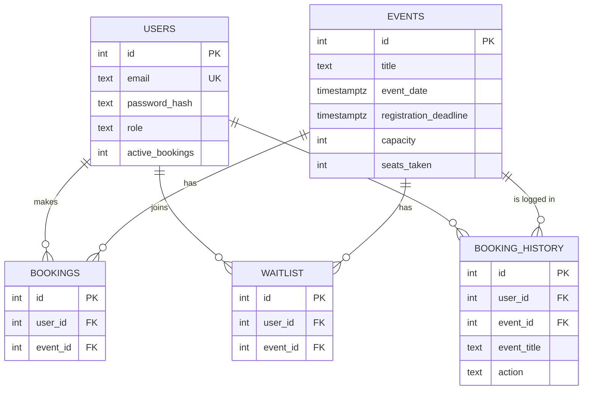

# College Event Registration & Seat Booking System

A full-stack web application where students browse college events, book seats, cancel, and join waitlists, and
administrators manage events and bookings. Its hard requirement is **concurrency**: when hundreds of students try to
book the last seats at the same moment, the system must never sell more seats than exist.

**Stack:** React + React Router + Axios (frontend) &middot; Node.js + Express REST API &middot; PostgreSQL (SQL, transactions,
row locking, constraints, indexes) &middot; JWT + bcrypt (auth) &middot; Postman, Jest/Supertest (testing).

## The idea in one paragraph (defence in depth)
Booking runs inside a database **transaction** that first locks the event row with `SELECT ... FOR UPDATE`, so
"check seats, insert booking, increase counter" is one atomic step. Behind that sits a second, independent layer:
`CHECK (seats_taken <= capacity)` on the events row, so the database itself refuses to go wrong even if the
application code is buggy or bypassed. A test harness proves it by firing 500 simultaneous requests at 100 seats,
once with the guard and once with the guard deliberately removed.

## Features
**Students:** register / login / forgot & reset password &middot; browse and search events &middot; event details with live seat bar &middot; book a seat
(with confirmation step) &middot; cancel &middot; join / leave a waitlist and get promoted automatically &middot; My Bookings &middot; Profile
(max 3 active bookings per student) &middot; booking history (every booking, cancellation and waitlist promotion is kept).
**Admins:** dashboard &middot; create / edit / delete events (capacity and optional registration deadline) &middot; view and cancel bookings per event (paginated) &middot; reports
(fill rate per event, bookings per day, data-integrity check).

Pages: Home, Events, Event Details (seat booking), My Bookings, Profile, Login, Register, and
Admin: Dashboard, Manage Events, Create/Edit Event, Manage Bookings, Reports.

## Setup

> **Upgrading from an older copy?** The database design changed (registration deadline + booking history table). Run `npm run setup` again to rebuild the tables (this deletes existing data), then `npm run seed`.

Requirements: **Node.js 18+** and **PostgreSQL 13+**.

```bash
git clone <repo-url>
cd <repo-folder>
npm run install:all             # installs backend AND client dependencies
cp .env.example .env            # Windows: copy .env.example .env   (then put your DB password in DATABASE_URL)
createdb event_booking          # or create the database "event_booking" in pgAdmin
npm run setup                   # tables + admin user + 4 sample events
npm run seed                    # optional: 5,000 students, 60 events, 10,000 bookings (volume test)
npm run build                   # builds the React app into client/dist
npm start                       # open http://localhost:3000
```

Logins: admin `admin@college.edu` / `admin123`. Seeded students: `student1@seed.test` ... `student5000@seed.test`
with password `password123`. You can also register new students on the Register page.

**Development mode (two terminals):** `npm start` (API on :3000) and `npm run dev:client` (React with hot reload on :5173).

## Commands
| Command | What it does |
|---|---|
| `npm run setup` | Drops and recreates all tables, adds admin + sample events |
| `npm run seed` | Adds 5,000 students, 60 events, 10,000 bookings (re-runnable) |
| `npm run build` | Builds the React frontend |
| `npm start` | Starts the server (serves the API and the built React app) |
| `npm run harness` | Concurrency harness, guard ON (Run A) |
| `GUARD=off npm run harness` | Concurrency harness, guard removed (Run B). PowerShell: `$env:GUARD="off"; npm run harness; $env:GUARD="on"` |
| `npm test` | 18 automated API tests (Jest + Supertest) |
| `npm run explain` | EXPLAIN ANALYZE of key queries (see `docs/INDEXES.md`) |
| `LOG_QUERIES=on npm start` | Prints every SQL statement with its run time (PowerShell: `$env:LOG_QUERIES="on"; npm start`) |

## Architecture
```
Browser (React) --axios--> Express REST API --pg--> PostgreSQL
   pages, state             routes -> middleware        tables, constraints,
   Router, Context          -> services (transactions)  transactions, indexes
```
```
client/src/pages        screens (student + admin)       client/src/api.js   axios + JWT header
client/src/context      login state (AuthContext)       client/src/hooks    useFetch (loading/error/data)
src/routes              auth, events, me, admin         src/middleware      JWT check, admin check
src/services            bookingService.js (the core)    db/                 schema, setup, seed, explain
tests/                  harness.js, api.test.js         postman/            API collection
```

## Database design


| Protection | Rule | Layer |
|---|---|---|
| `CHECK (seats_taken <= capacity)` | Never more bookings than seats (backstop) | Database |
| `CHECK (seats_taken >= 0)` | Counter can never go negative | Database |
| `CHECK (active_bookings BETWEEN 0 AND 3)` | Per-student limit backstop | Database |
| `UNIQUE (user_id, event_id)` on bookings and waitlist | One booking / one queue entry per student per event | Database |
| `CHECK (registration_deadline <= event_date)` | A deadline can never be after the event | Database |
| `booking_history` is insert-only | The past stays answerable after cancellations (the app never updates or deletes its rows) | Application |
| Foreign keys with `ON DELETE CASCADE` | No orphan bookings | Database |
| `SELECT ... FOR UPDATE` in a transaction | Serialises competing requests, gives clean 409s | Application |

A `CHECK` can only compare columns of the **same row**; it cannot count rows in `bookings`. That is why `events`
keeps a `seats_taken` counter next to `capacity`. Full SQL: [`db/schema.sql`](db/schema.sql). Indexes: [`docs/INDEXES.md`](docs/INDEXES.md).

## REST API
Send the token as `Authorization: Bearer <token>`.

| Method | URL | Who | Success |
|---|---|---|---|
| POST | `/api/auth/register`, `/api/auth/login` | public | 201 / 200 + token |
| POST | `/api/auth/forgot-password`, `/api/auth/reset-password` | public | 200 (reset link / password changed) |
| GET | `/api/events?search=`, `/api/events/:id` | public | 200 |
| POST | `/api/events/:id/book` | student | 201 `BOOKED` |
| DELETE | `/api/events/:id/book` | student | 200 `CANCELLED` (promotes the waitlist) |
| POST / DELETE | `/api/events/:id/waitlist` | student | 201 `WAITLISTED` / 200 |
| GET / PUT | `/api/me` | any user | profile / change name |
| GET | `/api/me/bookings` | any user | bookings + waitlist |
| GET | `/api/me/history` | any user | booking history, newest first (max 100) |
| POST / PUT / DELETE | `/api/events`, `/api/events/:id` | admin | 201 / 200 / 200 |
| GET | `/api/admin/stats`, `/api/admin/reports` | admin | 200 |
| GET | `/api/admin/events/:id/bookings?page=&limit=` | admin | 200 (paginated) |
| DELETE | `/api/admin/events/:id/bookings/:userId` | admin | 200 |

Errors always look like `{ "error": "CODE", "message": "..." }`:

| Situation | Status | Code |
|---|---|---|
| No seats left | 409 | `SOLD_OUT` |
| Already booked / already waitlisted | 409 | `ALREADY_BOOKED` / `ALREADY_WAITLISTED` |
| Student already holds 3 bookings | 409 | `LIMIT_REACHED` |
| Seats are free, so waitlist refused | 409 | `SEATS_AVAILABLE` |
| Admin lowers capacity below booked seats | 409 | `CAPACITY_BELOW_BOOKED` |
| Email already registered | 409 | `EMAIL_TAKEN` |
| Event / booking / waitlist entry not found | 404 | `EVENT_NOT_FOUND` / `BOOKING_NOT_FOUND` / `WAITLIST_ENTRY_NOT_FOUND` |
| Missing, invalid or expired token | 401 | `UNAUTHORIZED` |
| Wrong email or password | 401 | `INVALID_CREDENTIALS` |
| Not an admin | 403 | `FORBIDDEN` |
| Event already started | 409 | `EVENT_PAST` |
| Registration deadline passed | 409 | `REGISTRATION_CLOSED` |
| Too many login attempts | 429 | `TOO_MANY_REQUESTS` |
| Bad input, bad id or malformed JSON | 400 | `INVALID_INPUT` |
| DB CHECK blocked a write (only with `GUARD=off`) | 500 | `CONSTRAINT_VIOLATION` |
| Unexpected bug | 500 | `INTERNAL_ERROR` |

Server-side validation applies even when the React form is bypassed; `postman/event-booking.postman_collection.json`
sends invalid requests directly (bad email, short password, negative capacity, malformed JSON, wrong roles).

## Testing the hard requirement

**Scale target:** one event with 100 seats, 500 different students booking at the same moment, 10,000+ rows in the database.
**Expected:** exactly 100 x `201`, 400 x `409 SOLD_OUT`, 0 x `500`, `seats_taken = 100`, `COUNT(bookings) = 100`.

`npm run harness` starts the real Express app, creates users and signs a JWT for each, fires real HTTP requests with
`Promise.all`, then queries the database. Scenarios: (1) 500-request booking race, (2) cancellation race incl. duplicate
cancels, (3) waitlist promotion (15 waiting, 10 cancel at once), (4) per-student limit race, (5) the smallest race: 99 of 100
seats booked and two students take the last seat at once, repeated 10 times. With `GUARD=off` scenarios 1 and 5 run.

### Run A: guard ON (lock + availability check + CHECK)
Paste your own output here (`tests/results/run-A-guard-on.txt`):
```

> college-event-booking@1.0.0 harness
> node tests/harness.js


=== Scenario 1: 500 concurrent bookings for 100 seats (GUARD=on) ===
  500 requests finished in 405 ms
  Response tally:
     100 x 201 BOOKED
     400 x 409 SOLD_OUT
  PASS  201 responses: expected 100, got 100
  PASS  409 responses: expected 400, got 400
  PASS  409 all SOLD_OUT: expected 400, got 400
  PASS  500 responses: expected 0, got 0
  PASS  events.seats_taken: expected 100, got 100
  PASS  COUNT(bookings): expected 100, got 100

=== Scenario 5: last-seat race, 10 rounds (100 seats, 99 booked, 2 students book the last one at once) ===
  Response tally:
      10 x 201 BOOKED
      10 x 409 SOLD_OUT
  PASS  rounds with exactly one winner (one 201): expected 10, got 10
  PASS  rounds where seats_taken == capacity == COUNT(bookings): expected 10, got 10
  PASS  losers got a clean 409 SOLD_OUT: expected 10, got 10
  PASS  500 responses: expected 0, got 0

=== Scenario 2: cancellation race (100 users cancel at once + 9 duplicate cancels from user #1) ===
  Response tally:
     100 x 200 CANCELLED
       9 x 404 BOOKING_NOT_FOUND
  PASS  200 responses: expected 100, got 100
  PASS  404 responses (duplicates): expected 9, got 9
  PASS  500 responses: expected 0, got 0
  PASS  events.seats_taken: expected 0, got 0
  PASS  COUNT(bookings): expected 0, got 0
  PASS  students with active_bookings != 0: expected 0, got 0

=== Scenario 3: waitlist promotion (cap 10, 10 booked, 15 waiting, 10 cancel at once) ===
  Response tally:
      10 x 200 CANCELLED
  PASS  200 responses: expected 10, got 10
  PASS  500 responses: expected 0, got 0
  PASS  events.seats_taken (still full): expected 10, got 10
  PASS  seat holders are exactly the first 10 in the queue 
  PASS  people still on waitlist: expected 5, got 5

=== Scenario 4: per-student limit (1 student, 10 concurrent bookings on 10 events, limit 3) ===
  Response tally:
       3 x 201 BOOKED
       7 x 409 LIMIT_REACHED
  PASS  201 responses: expected 3, got 3
  PASS  409 LIMIT_REACHED: expected 7, got 7
  PASS  500 responses: expected 0, got 0
  PASS  users.active_bookings: expected 3, got 3

ALL CHECKS PASSED

```

### Run B: guard REMOVED (no lock, no availability check; only the CHECK remains)
Paste your own output here (`tests/results/run-B-guard-off.txt`):
```

> college-event-booking@1.0.0 harness
> node tests/harness.js


=== Scenario 1: 500 concurrent bookings for 100 seats (GUARD=OFF) ===
  500 requests finished in 388 ms
  Response tally:
     100 x 201 BOOKED
     400 x 500 CONSTRAINT_VIOLATION
  (guard removed: some requests may fail with CHECK violations - the DATA must still be correct)
  INFO  400 requests were stopped by the database CHECK constraint
  PASS  seats_taken <= capacity (100 <= 100)
  PASS  seats_taken == COUNT(bookings): expected 100, got 100
  PASS  seats_taken == number of 201s: expected 100, got 100
  PASS  no network errors 

=== Scenario 5: last-seat race, 10 rounds (100 seats, 99 booked, 2 students book the last one at once) ===
  Response tally:
      10 x 201 BOOKED
      10 x 500 CONSTRAINT_VIOLATION
  PASS  rounds with exactly one winner (one 201): expected 10, got 10
  PASS  rounds where seats_taken == capacity == COUNT(bookings): expected 10, got 10
  INFO  10 losing requests were stopped by the database CHECK constraint

ALL CHECKS PASSED

```

**Reading the two runs side by side:** with the guard the 400 extra students get a clean `409 SOLD_OUT`. Without it they get
`500` errors because the database rejects them, **but the data is still correct**. The application logic gives correct
*behaviour*; the constraint gives correct *data*.

**Manual two-window test (as in the proposal):** open two browsers, log in as two students, and click *Confirm booking*
on the last seat of "Tiny Seminar" in both. Exactly one succeeds; the other sees "No seats left".

Other tests: `npm test` (18 Jest + Supertest API tests) and the Postman collection (34 requests, import it and run it with the Collection Runner).

## Deployment
**Docker (easiest):** create a `.env` with `JWT_SECRET=<long random string>` and `ADMIN_PASSWORD=<strong password>`, then
`docker compose up --build` and, the first time, `docker compose exec app node db/setup.js`. Open http://localhost:3000.
**Any host (Render, Railway, a VPS):** set `NODE_ENV=production`, `DATABASE_URL`, `JWT_SECRET`, `ADMIN_PASSWORD`; build command
`npm run install:all && npm run build`; start command `npm start`; run `npm run setup` once. Health check: `GET /api/health`.
Use HTTPS in front of the server (the host usually does this); JWTs are sent in a header and must not travel over plain HTTP.

## Hardening and fixes in this version
- **Bug fixed:** deleting an event removed its bookings but left each student's `active_bookings` counter too high, so students
  silently lost booking slots. Deletion now runs in a transaction that corrects the counters (`deleteEvent`, covered by a test).
- **Bug fixed:** cancel / admin-edit can promote waitlisted students who are shared by several events; in rare cases PostgreSQL
  aborts one transaction as a deadlock. Those transactions are now retried automatically instead of returning a 500.
- Booking and waitlisting are refused for events that already started (`409 EVENT_PAST`); the React page hides the buttons.
- Sample events are created relative to today, so the demo never goes stale.
- Login/register are rate limited (100 attempts / 15 min / IP, change with `AUTH_RATE_LIMIT`), basic security headers, 50 kb JSON limit, `/api/health`,
  graceful shutdown, DB pool error handler, and the server refuses to start in production without `JWT_SECRET`.
- Docker + docker-compose for one-command deployment.
- Redesigned interface (modern cards, date badges, seat-status badges, show/hide password, mobile friendly) and a Forgot / Reset password flow.

## Forgot password
Login page -> *Forgot password?* -> enter email -> a reset link is created (valid 15 minutes, works once) -> choose a new password.
There is no email server in this project, so the link is shown on the page and printed in the server console (in production the
page does not show it; connect an email service such as Nodemailer / SendGrid to send it). The reset token uses its own secret, so it can
never be used as a login token, and it stops working as soon as the password changes.

## Future scope
Email confirmations, numbered seat selection, QR check-in, live updates with Socket.io, deployment.
